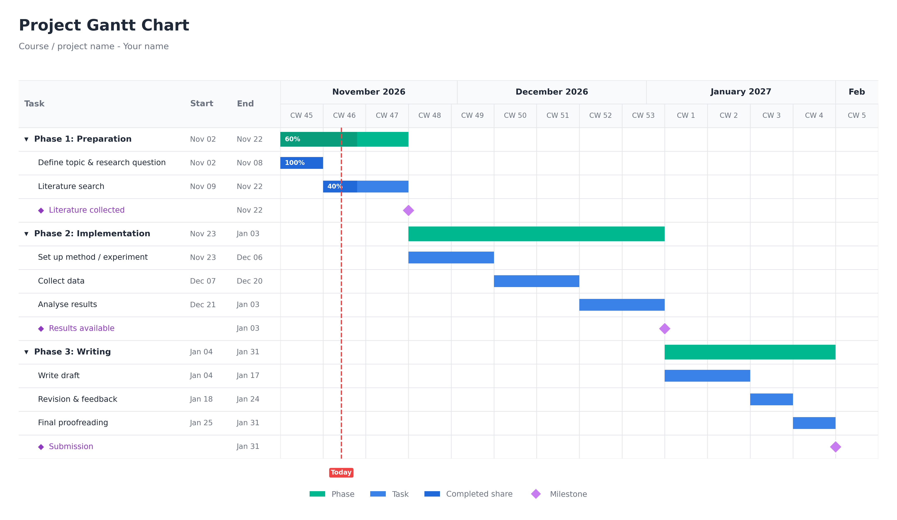
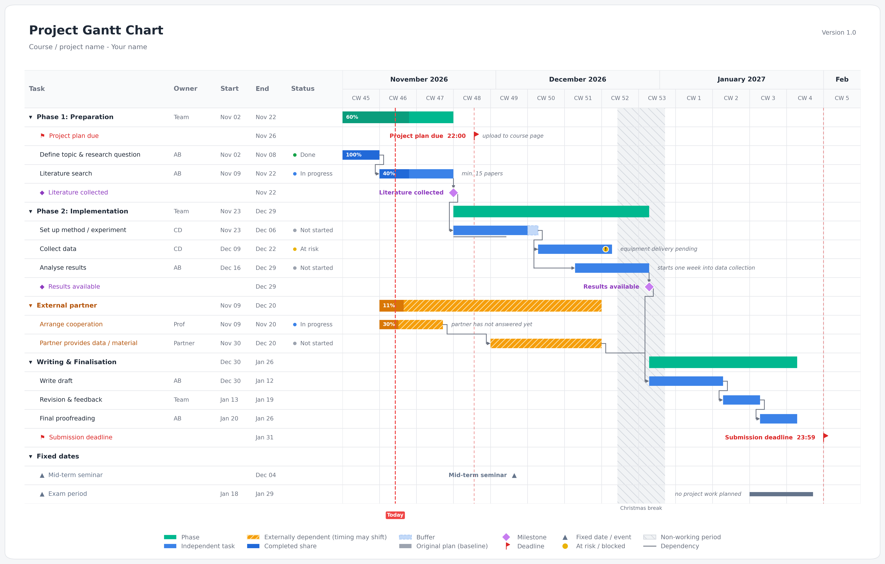

## GANTT-Template-for-Python

Modern-looking GANTT charts from a few lines of Python. Describe your project once (phases, tasks, milestones), run a single file, and get a clean, high-resolution picture you can drop into a report, a poster, a presentation or a README.

Everything here is free to use, copy and adapt. No account, no web service, no subscription, just Python.

**What you get**

- A clean, modern design with phases, tasks, milestones, progress, calendar weeks and a "today" line
- One file per template, nothing to install except two common libraries
- A picture in print quality (PNG, 300 dpi; PDF and SVG work too)

## The three templates

All three produce the same style of chart. They differ in how much they can do.

| Template | Best for | File |
|----------|----------|------|
| **Basic** | A quick overview of a simple project | [`GANTT-chart-template-basic-size`](GANTT-chart-template-basic-size) |
| **Medium** | Real projects with dependencies, deadlines and responsibilities | [`GANTT-chart-template-medium-size`](GANTT-chart-template-medium-size) |
| **Advanced** | Learning every feature from a fully commented example | [`GANNT-chart-template-avanced-size`](GANNT-chart-template-avanced-size) |

### Basic

The simplest version: phases, tasks and milestones, and nothing else. A task has a name, a start date, an end date and, if you like, a progress value. A whole plan fits into about 15 lines, and the code is short enough to read and change.

### Medium

The full-featured template. On top of everything in Basic it can:

- draw **dependency arrows** between tasks (finish-to-start, start-to-start, finish-to-finish, with optional lag)
- calculate dates for you: give a **duration** instead of an end date and a task starts automatically after the one it depends on
- show **deadlines** (with time of day) and **fixed dates / events**
- add **owner, status, priority and notes** to every row, as table columns and remarks next to the bars
- mark tasks that depend on **external partners** (orange, hatched)
- add **buffers**, show the **original plan** (baseline) next to the current one, and give any bar its own color
- skip **weekends, holidays and breaks** when counting working days
- translate every label (for example "CW" to "KW")

The example plan is a typical small research project.

### Advanced

The same engine and the same features as Medium. The difference is the example: a research project in four parts (Step 1, Step 2, Cooperation and Step 3) that uses **every single feature at least once**, with a comment on each line saying what it does. Use it to find out what is possible, then copy the lines you need into your own plan.

## Made openly with AI

These templates were created openly together with an AI assistant, [Claude](https://claude.ai) by Anthropic. I described what I needed (the look, the features and how it should be used), the AI wrote the code and tested it with example plans and with deliberately broken plans, and I reviewed the results and tried them myself. This README was written with the same assistant.

I am sharing this openly because you should know how what you are using came about. The code is AI-generated. It works well for the plans I tried, but it comes without any warranty, so please check the chart you create for your own project. If something looks wrong, let me know.

## Feedback

Found a bug, or missing a feature? Please open an issue. Ideas and improvements are welcome.
